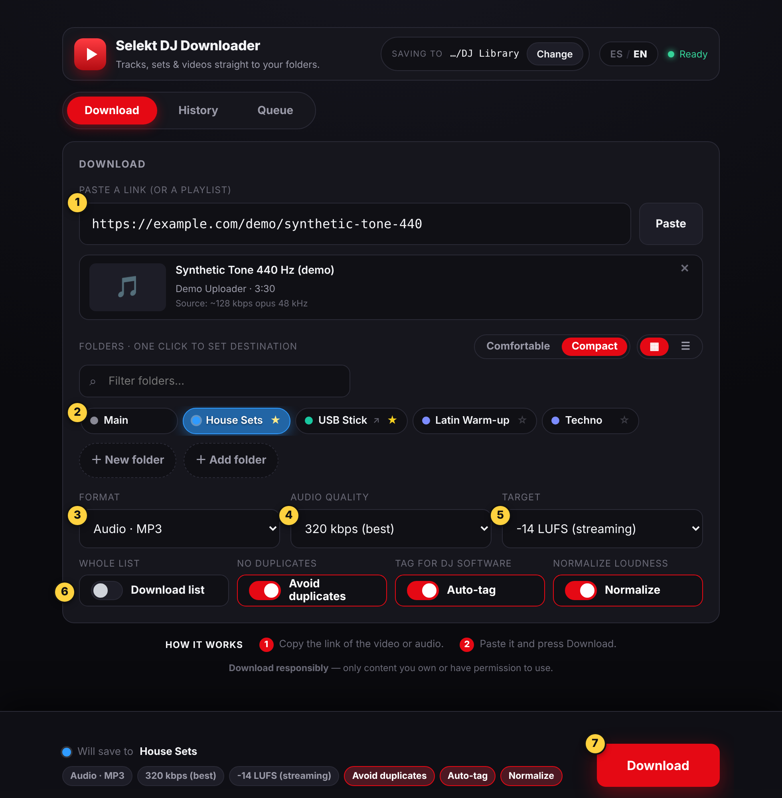

# Selekt DJ Downloader — desktop app (source)

Paste a link, pick a folder, press **Download**. Selekt DJ Downloader is an Electron desktop app that saves
audio or video into folders you organise yourself (one per genre, gig or project), using
[yt-dlp](https://github.com/yt-dlp/yt-dlp) and [ffmpeg](https://ffmpeg.org/) under the hood.

> **Status: source code only.**
> This repository does **not** provide an installer. There is **no signed or notarized Mac app**, and no
> `.dmg`, `.exe` or AppImage to download. To try the app you run it from source (see [Quick start](#quick-start)).
> Windows (NSIS) and Linux (AppImage) build targets exist in the build configuration, but they have **not been
> built or tested** and are not releases. No clean-machine build or run of a packaged app is claimed.

<p align="center">
  
</p>

*The Download tab with its defaults. Screenshots use synthetic data; see
[About the screenshots](docs/USER_GUIDE.md#about-the-screenshots) in the guide.*

## What it does

- **Download audio or video** from a pasted link: MP3 or M4A (128, 192 or 320 kbps), WAV or FLAC for audio; Original, 1080p, 720p or Best for video.
- **Folders for your library.** Pick one main folder (it defaults to `~/Downloads` until you choose), create sub-folders, add favourite folders from anywhere (a USB stick, say), and choose the destination with one click.
- **Safer defaults for DJ use:** MP3, 320 kbps, loudness normalisation on at −14 LUFS, Avoid duplicates on, Auto-tag on, playlist download off.
- **Queue** for many links at once: Active (waiting / running / failed) vs Completed files, with pause, cancel,
  retry, Show, Locate, and list-only clear. The sequential runner lives in the main process (window reload does
  not duplicate the active item). Move / Convert / Add local files are not in this build.
- **Honest warnings:** if loudness normalization is on but cannot be completed, the file is kept at its original loudness and the app says so. Cancelling part-way through a list keeps the finished files and says how many were normalized.
- **History** of recent downloads with Play, Show in folder and Copy link.
- **Playlists** with a track picker.
- **Optional extras:** a watch-folder inbox, audio-fingerprint duplicate detection (needs the separate `fpcalc` tool), and browser cookies for sign-in-only content. All three are off by default.
- **Spanish and English** interface (Spanish is the default; switch with the ES / EN button).

Normalisation and conversion cannot add quality that the source does not have. A 128 kbps source stays a
128 kbps-quality source, whatever you convert it to. The [guide](docs/USER_GUIDE.md) explains this and every switch.

## Responsible use

Selekt DJ Downloader is intended for content you own, content you have permission or a license to download, and content that is otherwise lawful for you to download.

Respect copyright, creators' rights, applicable laws, and the terms of the services you use. Access to a video or audio file does not necessarily mean you have permission to download or redistribute it.

You are responsible for checking that your use is authorized. Do not use this app to bypass technological protection measures or access content without authorization.

This notice is general guidance, not legal advice, and it does not limit or replace your own legal responsibilities.
The app shows a one-line reminder of the same idea at the bottom of its window. This project is not affiliated
with or endorsed by yt-dlp, ffmpeg, YouTube or any other site or service.

## Quick start

Requirements: **macOS 13 (Ventura) or newer** (the minimum declared by Electron 44), plus Node.js and npm.
Only one Mac was used for review: **Apple silicon (arm64)**. macOS 13 itself and Intel Macs are untested.

First open the project folder you downloaded or cloned (the one that contains `README.md` and `app`). In Terminal,
type `cd ` and drag that folder from Finder onto the window, then press Return. Then copy and paste:

```bash
ls              # should list README.md, app, docs, LICENSE ...
cd app          # all npm commands run inside app
npm ci          # [Observed] installs dependencies, including Electron 44.10.2
npm start       # runs "electron ." — see the note below
```

Step-by-step help is in the [guide](docs/USER_GUIDE.md#steps). This runs the app from source; there is no installer.

- `npm ci` was run successfully on the review Mac. `npm start` itself was **not** the command used for the
  review run: the app was launched with `./node_modules/.bin/electron .` plus an isolated `--user-data-dir`.
  `npm start` runs the same `electron .`, but that exact command is **not verified**.
- The first download fetches the yt-dlp engine from GitHub, so you need an internet connection. The app
  verifies the binary's **SHA-256** against that release's `SHA2-256SUMS` file and keeps the previous copy
  for rollback if the new file is bad. That is **not** a signature check. Details are in the
  [guide](docs/USER_GUIDE.md#first-run-the-download-engine).
- A clean-Mac, from-scratch run (no pre-existing Node, caches or data) has **not** been done.

## Documentation

| Read this | For |
|---|---|
| [User guide](docs/USER_GUIDE.md) | Step-by-step use of every screen, every switch, the queue, History, Settings, troubleshooting, and what has and has not been tested |
| [Known quirks](docs/USER_GUIDE.md#known-quirks) | Behaviours found by reading the source that may surprise you |
| [Testing status](docs/USER_GUIDE.md#testing-status) | What was observed, what is only unit-tested, and what is untested |

## Working with the source

| Path | What is in it |
|---|---|
| `app/main.js` | Main process: downloads, queue, history, settings, engine setup |
| `app/preload.js` | Bridge between the window and the main process |
| `app/renderer/` | The window: HTML, CSS and JavaScript (Spanish and English text) |
| `app/test/` | Node unit tests (stand-ins for Electron, yt-dlp, ffmpeg and the network) |
| `app/test-browser/` | Optional browser-based layout and accessibility checks |
| `app/build/` | Build resources (see `ARTWORK.md`) |
| `THIRD_PARTY_INVENTORY.md` | Draft list of third-party components |

Run the unit tests with:

```bash
node --test app/test/*.test.js
```

Latest Linux run (this Phase 1 pass): **231 of 231 passed** (Node 22.23.4, sequential). That count includes
the older normalization / destination tests plus Phase 1 reliability and audio-safety tests. An earlier Mac
run of the pre-Phase-1 suite was 193/193 (macOS 27.0.1, Apple silicon, Node 26.11.1). One test file needs
Node 20.4 or newer. These tests use stand-ins for yt-dlp and Electron, so they do not prove that real downloads
or conversion work. One generated 1 s sine was measured with real ffmpeg 6.1.1 on Linux for the loudnorm JSON
gate. Mac packaging/runtime was **not** re-tested (user Mac offline). See the
[guide](docs/USER_GUIDE.md#if-normalization-fails).

**Phase 1 (reliability / audio safety)** is implemented on this branch: atomic `queue.json` / `config.json`,
actionable `errorCode` plus visible cookie/engine retries, SHA-256-verified yt-dlp with `.bak` rollback,
`dest_unmounted` for disconnected favorites, remembered format/bitrate after you change them, copy-when-source
matches (unknown source bitrate is copied and not reported as the requested kbps), loudnorm I/TP gate (keep −9 LUFS, no limiter), and a main-owned sequential queue. Fingerprint stays
flag-only. Intel, signing, presets and UI redesign are **not** in this phase.

**Latest Mac smoke test (a spot check, not a full test).** On the review Mac (Apple silicon) the app was started with a new,
isolated data folder, and one public-domain Wikimedia 1000 Hz test tone was downloaded through the app window with the
defaults: MP3 320 kbps, Normalize on at −14 LUFS. The saved file measured **−14.0 LUFS**. Limits:
it was one mono tone; no listening was confirmed; the engine files (ffmpeg, ffprobe, yt-dlp) were copied from an earlier
review folder, so the ffmpeg was **not** a verified fresh install of this candidate's package; pressing **Enter** in the
link box submitted the link, while two presses of the **Download** button sent through macOS background (accessibility)
control did not register, and the cause is **not confirmed**; a real mouse click on Download was not tried in that run.
Details: [latest smoke test](docs/USER_GUIDE.md#latest-mac-smoke-test) in the guide.

**Build configuration.** `app/package.json` defines electron-builder targets (`dist`, `dist:mac`, `dist:win`
scripts): macOS `dmg`, Windows `nsis`, Linux `AppImage` (no npm script for Linux). "Configured" means a target
exists in `package.json`. It does not mean the build succeeds, runs, is signed or notarized, or has been tested
on that platform. No installer has been built from this source. If you build one yourself it will be unsigned
unless you set up signing.

## Licence and artwork

- **Source code: MIT.** See [`LICENSE`](LICENSE). `app/package.json` declares the same (`"license": "MIT"`).
- **Brand artwork: not under the MIT licence.** The app icons in `app/build/` (`icon.png`, `icon.icns`,
  `source/selektdj-k-icon.svg`) are the SelektDJ brand mark, included here with the repository owner's
  permission. They are excluded from the MIT licence: no rights to them or to the SelektDJ name are granted,
  and no reuse terms are stated in this repository. See [`app/build/ARTWORK.md`](app/build/ARTWORK.md). If you
  fork or redistribute, replace them with your own artwork.
- **Third-party software** keeps its own licences: see [`THIRD_PARTY_INVENTORY.md`](THIRD_PARTY_INVENTORY.md),
  a draft inventory, not a compliance statement. Notably, the app bundles ffmpeg through `ffmpeg-static`,
  which is GPL-3.0-or-later; what that means for distributing a built installer has not been resolved.

## Related components

A separate MCP server and a downloadable macOS installer are separate, future releases. Neither is part of
this repository.
