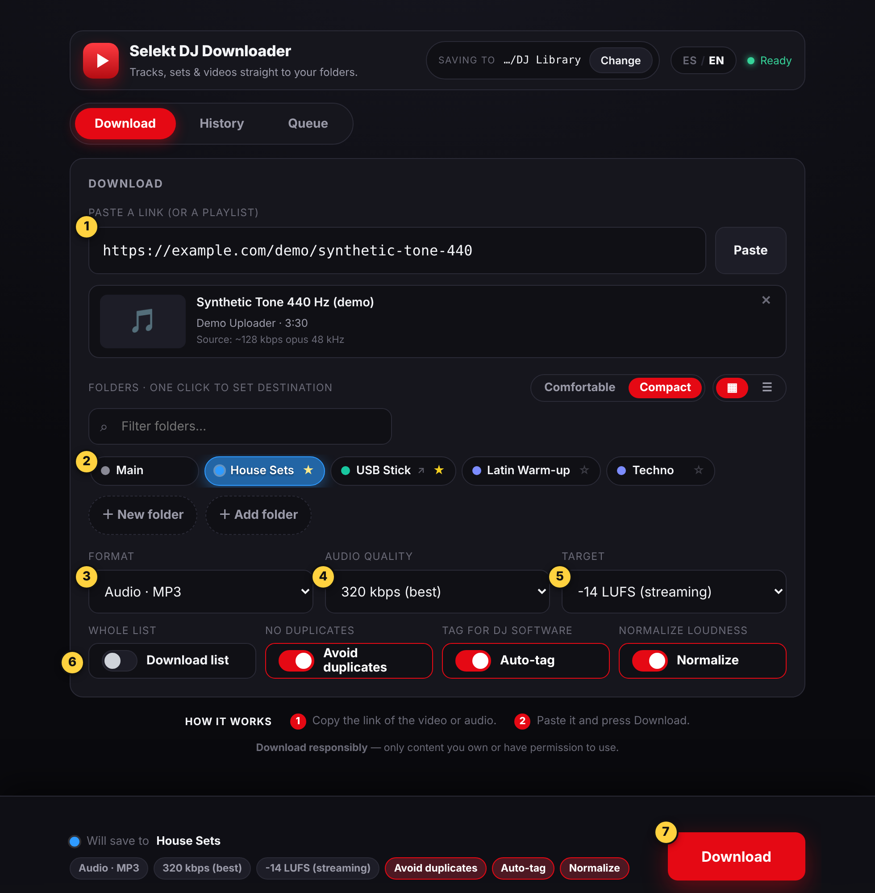
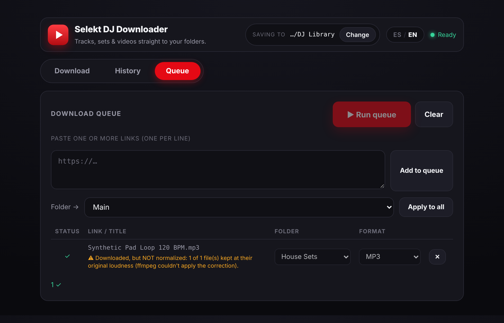
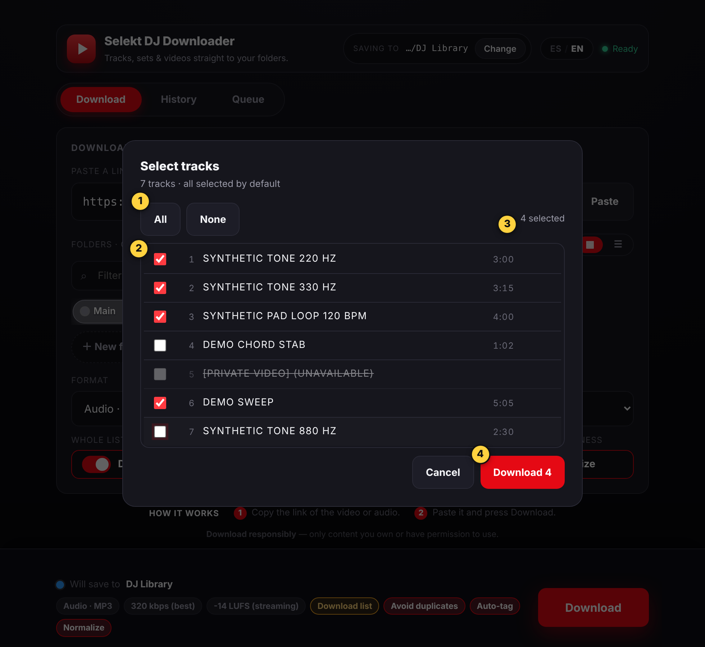
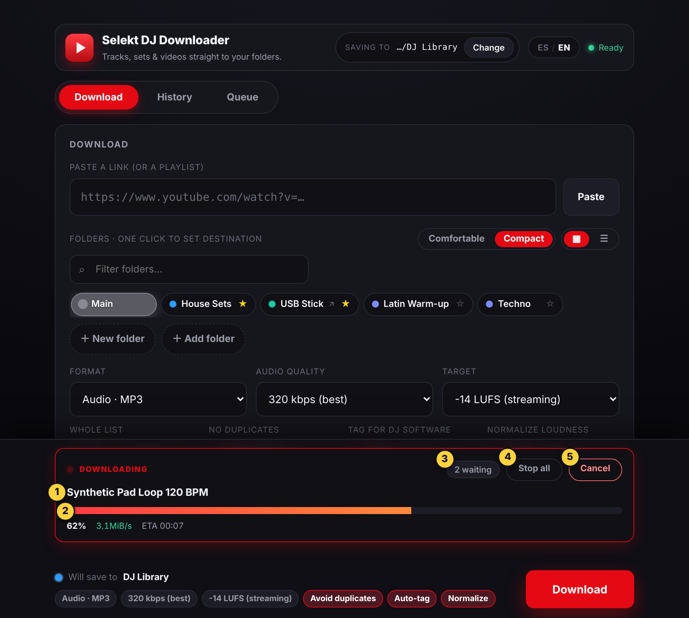
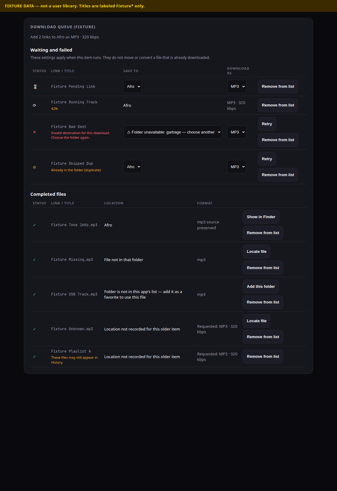
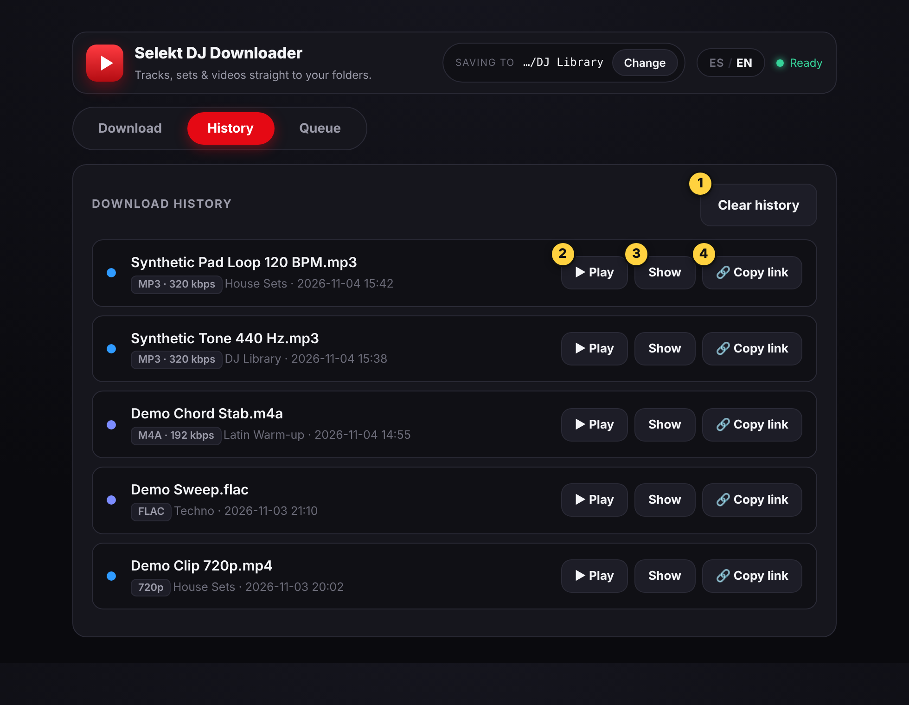
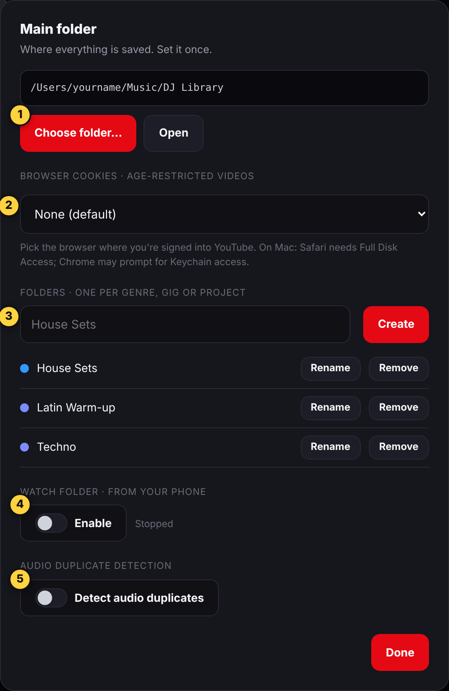
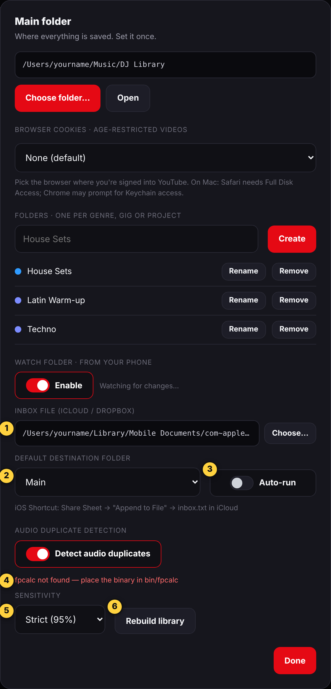

# Selekt DJ Downloader — User Guide

[← Back to the README](../README.md)

> **This repository is source code only.** There is no installer, and **no signed or notarized Mac app**.
> You run the app from source. Windows and Linux build targets exist in the configuration but are **not built,
> tested or released**. This guide is written for the Electron 44 review candidate (app version 1.1.0).

## How to read this guide

Every behaviour below carries one of four tags, so you can see how far to trust it:

| Tag | Meaning |
|---|---|
| **[Observed]** | Seen working in a real Electron run of this candidate on one Apple-silicon Mac. |
| **[Unit-tested]** | Covered by the repository's Node tests. Those tests use **stand-ins** for Electron, yt-dlp, ffmpeg and the network, so they show the code's logic, not real-world results. |
| **[Measured]** | Run with the real ffmpeg program on test files, outside the app window. The setup is stated each time it is used (it was not the app's bundled ffmpeg, and not on a Mac). |
| **[Not tested]** | Described from reading the source code. Nobody has run it end to end. It may work as described, but it is not confirmed. |

If a step has no tag, it is plain navigation (clicking a visible button). Where the source and the evidence do not
settle something, the guide says so instead of guessing.

**Contents**

1. [What the app does](#what-the-app-does)
2. [Responsible use](#responsible-use)
3. [Get the source and run it](#get-the-source-and-run-it)
4. [A tour of the window](#a-tour-of-the-window)
5. [Folders: main folder, sub-folders, favourites](#folders-main-folder-sub-folders-favourites)
6. [Download a track or video](#download-a-track-or-video)
7. [Defaults and switches](#defaults-and-switches)
8. [Playlists](#playlists)
9. [Progress, Cancel and Stop all](#progress-cancel-and-stop-all)
10. [The Queue](#the-queue)
11. [History](#history)
12. [Settings](#settings)
13. [First run: the download engine](#first-run-the-download-engine)
14. [Troubleshooting](#troubleshooting)
15. [Known quirks](#known-quirks)
16. [Testing status](#testing-status)
17. [Where the app keeps its data](#where-the-app-keeps-its-data)
18. [About the screenshots](#about-the-screenshots)

---

## What the app does

Selekt DJ Downloader saves audio or video from a link you paste into folders you choose. It runs
[yt-dlp](https://github.com/yt-dlp/yt-dlp) to fetch the media and [ffmpeg](https://ffmpeg.org/) to convert it.
The window is available in Spanish and English (Spanish first; switch with **ES / EN** in the header).
It has three tabs (**Download**, **History**, **Queue**) and a Settings window.

It is built around a DJ's habits: one library folder, sub-folders per genre or gig, consistent loudness, no
duplicates, and tags that DJ software can read.

---

## Responsible use

Selekt DJ Downloader is intended for content you own, content you have permission or a license to download, and content that is otherwise lawful for you to download.

Respect copyright, creators' rights, applicable laws, and the terms of the services you use. Access to a video or audio file does not necessarily mean you have permission to download or redistribute it.

You are responsible for checking that your use is authorized. Do not use this app to bypass technological protection measures or access content without authorization.

This notice is general guidance, not legal advice, and it does not limit or replace your own legal responsibilities.
The app shows a one-line reminder of the same idea at the bottom of the Download tab ("Download responsibly — only
content you own or have permission to use."). That line is a short summary; the notice above is the full wording.
This project is not affiliated with or endorsed by yt-dlp, ffmpeg, YouTube or any other site or service.

Two features need extra care under this notice:

- **Browser cookies** let the app act as your signed-in browser. Use them only for your own account and for
  content you are entitled to access. See [Browser cookies](#browser-cookies-optional).
- **Watch folder** queues whatever links appear in a text file. Only put links there that you are entitled to download.

---

## Get the source and run it

### What you need

- **macOS 13 (Ventura) or newer.** This is the minimum declared by Electron 44.10.2 (its `LSMinimumSystemVersion`
  is 13.0). The app itself declares no other requirement.
- **Node.js and npm** to install dependencies. The review used Node 26.11.1. One test file needs Node 20.4 or
  newer. Other versions are untested; the project does not set an `engines` field.
- **An internet connection** for `npm ci` (downloads Electron and packages) and for the first download (fetches yt-dlp).
- **Optional:** `fpcalc` (Chromaprint), only if you want audio-fingerprint duplicate detection.

### Steps

All the commands below run from inside the project's **`app`** folder. To get there, first open the project folder
you downloaded or cloned.

1. **Get the project folder.** Until the repository is published you receive the folder directly. Once it is
   published you will be able to download it as a ZIP (unzip it by double-clicking it in Finder) or clone it. The
   result is one folder that contains `README.md`, `LICENSE`, `docs` and `app`. That is the **project folder**. It is
   not the `app` folder inside it, and not the ZIP file.
2. **Open Terminal** (press Command-Space, type *Terminal*, press Return).
3. **Open the project folder in Terminal.** Type `cd ` (the letters c, d and a space), then drag the project folder
   from Finder onto the Terminal window. Terminal types its path for you. Press Return.
4. **Check you are in the right place, then go into `app`, then install and start.** Copy and paste this block:

```bash
ls              # should list README.md, app, docs, LICENSE ...
cd app
ls              # should list package.json, main.js, renderer ...
npm ci
npm start
```

If `npm` says it cannot find `package.json`, you are not inside `app`. Run `pwd` to see where you are and go back to
step 3. (This is how npm behaves in general; the wrong-folder case was not tried here.)

This is a source-only repository: running these commands starts the app from source. There is no installer to
double-click, and nothing is signed or notarized.

| Step | Status |
|---|---|
| `npm ci` installs dependencies, including Electron 44.10.2 (darwin-arm64) | **[Observed]** on the review Mac. A warning appeared about the `ffmpeg-static` install script; the ffmpeg binary was present afterwards. |
| The window opens | **[Observed]**, but launched as `./node_modules/.bin/electron . --user-data-dir=<test folder>`, not with `npm start` |
| `npm start` (runs `electron .`) | **[Not tested]** as written. It runs the same program, but the exact command was not the one used. |
| Running on a clean Mac with no earlier Node, caches or app data | **[Not tested]** |
| Intel Macs and macOS 13 | **[Not tested]** (review Mac: Apple silicon) |
| Windows and Linux | **[Not tested]**. Build targets are configuration only. |

`npm ci` may report vulnerabilities in development dependencies (`npm audit` reported 25 in the review run). They
come from build and test tooling, not from code the window runs, but they have not been analysed in detail.

### Optional: keep a test run separate from your real data

To try the app without touching any existing settings or history, point it at a scratch folder (**[Observed]**
as the way the review run was started). Run this from the `app` folder (step 4), instead of `npm start`:

```bash
./node_modules/.bin/electron . --user-data-dir="$HOME/selekt-test-data"
```

### First launch

The app opens on the **Download** tab. It saves into your main folder; until you choose one, that is `~/Downloads`.
If an earlier session left items waiting in the queue, a **Resume** banner appears.

---

## A tour of the window



*Figure 1. The Download tab at its defaults. Yellow numbers were added for this guide: (1) paste box, (2) folders,
(3) format, (4) audio quality, (5) loudness target, (6) the four switches, (7) Download button. The row of chips
above the button repeats your current choices.*

- **Header:** app name, **Saving to** (the last part of your main folder's name) with a **Change** button that opens
  [Settings](#settings), the **ES / EN** language switch, and a status light.
- **Tabs:** **Download**, **History**, **Queue**. Settings is not a tab; it is a window opened by **Change**.
- **Action bar (Download tab only):** shows where the file will go and your current choices, and holds the
  **Download** button. While something is downloading it also shows the progress card.
- **Scrolling:** at the default window size (980 × 760) the four switches sit below the visible area, behind the
  action bar. Scroll the Download tab down to reach them, or make the window taller.

---

## Folders: main folder, sub-folders, favourites

Your **main folder** is the root of your library. Sub-folders you create live inside it. A favourite is any other
folder you point the app at (for example a USB stick).

### Choose the main folder

1. Click **Change** in the header. The **Main folder** window opens (Figure 6 below).
2. Click **Choose folder…** and pick a folder in the system folder dialog. **Open** shows it in Finder.

The choice is saved. **[Observed]**: a fresh run showed the main-folder control; the folder dialog itself was not
exercised in the review.

### Create a folder

In the **Main folder** window, type a name next to **Create** and click it. Or use **+ New folder** on the Download tab.
Names cannot contain `/` or `\`, cannot end in a dot or a space, and cannot contain control characters (on Windows,
reserved names are rejected too). **[Unit-tested]** for name checking; creating a real folder **[Not tested]**.

### Add a favourite folder

Click **+ Add folder** on the Download tab and pick any folder. It appears as a chip with a small **↗** and is
pinned automatically. A favourite is exactly that folder: the app does not list its sub-folders. **[Not tested]**

### Pick the destination

Click a folder chip: it becomes the destination ("Will save to …" in the action bar). Click **Main** to save straight
into the main folder.

- The star (★) on a chip pins it so it stays prominent. Click the star to pin or unpin.
- **Right-click** a chip for **Open folder**, **Rename**, **Remove** and **Remove from favourites**.
- The filter box narrows long lists. **Comfortable / Compact** changes spacing, and the two icons switch between chips
  and a list (the list also shows file counts).
- The destination **resets to Main each time the app starts**.

### Rename and remove

- **Rename** renames the folder **on disk**. History entries are not updated, so older History rows for files in a
  renamed folder may no longer open (see [Known quirks](#known-quirks)).
- **Remove** takes the folder out of the app's list only. **It does not delete the folder or its files.**
- Only sub-folders the app can see directly inside your main folder are listed.

### Find a downloaded file

- Use **History → Show** to reveal the file in Finder, or open the folder with **Open** in Settings or **Open folder**
  in the chip menu.
- Files are saved as `<destination>/<title>.<ext>`. Playlists go into a sub-folder named after the playlist, as
  `<NN> - <title>.<ext>`. **[Not tested]** with real playlists.

---

## Download a track or video

1. **Paste a link** into the box (or click **Paste**). Only `http://` and `https://` links are accepted.
2. After about a second the app looks the link up and shows a **preview card**: title, uploader, duration and a line
   such as *Source: ~128 kbps opus 48 kHz*. That line is the quality of what the site offers; it matters for the
   [quality rule](#a-higher-bitrate-cannot-add-quality) below. If the title matches one of your folder names, a
   suggested-folder chip may appear. **[Unit-tested]**; the preview with a real site **[Not tested]**.
3. **Choose the destination folder** (chip).
4. **Choose Format.**
   - **Audio:** MP3, M4A, WAV, FLAC.
   - **Video:** *Original* (keeps the source streams, remuxed to MP4 or MKV with no re-encode, fast), *1080p*, *720p*,
     *Best quality*. The capped and Best options merge to MP4.
5. **Choose Audio quality** (MP3 and M4A only): 320 kbps (best), 192 kbps, 128 kbps (light). WAV and FLAC have no
   bitrate choice.
6. Check the four switches (see [Defaults and switches](#defaults-and-switches)).
7. Click **Download**. (Pressing Enter in the link box also submits the link; see the
   [latest smoke test](#latest-mac-smoke-test) below for what was and was not confirmed about the button.)

Every press of **Download** goes through the queue: the item is added, and the queue runs items one after another.
You can watch it on the Download tab ([progress card](#progress-cancel-and-stop-all)) and on the
[Queue tab](#the-queue).

Evidence: **[Observed]** two real downloads of the same public-domain 1000 Hz test tone from Wikimedia Commons, in two
review runs. The earlier run saved it as MP3 192 kbps with **Normalize off** and **Auto-tag on**; the file existed
(42,488 bytes) and appeared in History. The latest run, a smoke test described next, used the defaults: MP3 320 kbps
with **Normalize on** at −14 LUFS. Nothing else has been observed through the app window: no video, playlists, other
sites or real music. (Show and Play were tried in an earlier review session; see [History](#history). Normalisation was
also measured separately on test files; see [Normalize](#normalize-14-lufs-or-9-lufs).)

### Latest Mac smoke test

A spot check made during final preparation (4 November 2026) on one Apple-silicon Mac. **[Observed]** unless stated.

- **Setup:** a new, isolated data folder and an empty download folder. The engine files (yt-dlp, ffmpeg, ffprobe) were
  **copied from an earlier review folder**, not freshly installed from this candidate's `ffmpeg-static` and
  `ffprobe-static` packages, so this run does **not** verify a fresh install. The copied yt-dlp matched the published
  SHA-256 for `yt-dlp_macos`. The ffmpeg was version 6.0.
- **Defaults shown:** MP3 · 320 kbps · −14 LUFS, with Avoid duplicates, Auto-tag and Normalize on and no playlist.
- **Download:** the Wikimedia 1000 Hz tone, with those defaults left unchanged, so **Normalize was on at −14 LUFS**. The
  window ended with its normal success message (no *not normalized* warning); the Queue record showed *done* with no
  error, and one History row was written.
- **Output:** one MP3 of 82,753 bytes: 320 kbps, 48 kHz, **mono**, 2.04 seconds. Measured outside the app with the same
  copied ffmpeg (EBU R128 meter): **−14.0 LUFS** integrated, true peak −10.4 dBFS. The earlier Normalize-off file of
  the same tone measured −7.4 LUFS. Reading the tags with ffprobe showed title, comment (the link) and genre (the name
  of the destination folder); there was no artist tag.
- **How the download was started:** pressing **Enter** in the link box submitted the link and queued the download.
  Two presses of the **Download** button, sent through macOS background (accessibility) control, queued nothing. The cause
  is **not confirmed**: it may be how the button was pressed rather than the app. A real mouse click on Download was
  **not tried** in this run.
- **Limits:** one mono tone, not music. No listening was confirmed. The file was not opened in Apple Music. Nothing
  else was exercised (no cancel, watch folder, fingerprints, playlists or video).

---

## Defaults and switches

A new session starts with these values:

| Setting | Default | Remembered between launches? |
|---|---|---|
| Format | **MP3** | Yes, once you change it |
| Audio quality | **320 kbps** | Yes, once you change it |
| Normalize | **On**, target **−14 LUFS** | Yes, once you change it |
| Avoid duplicates | **On** | Yes, once you change it |
| Auto-tag | **On** | Yes, once you change it |
| Download list (playlist) | **Off** | No, always off at launch |
| Destination | Main folder | No |

**[Observed]**: a fresh run's Download tab showed MP3 · 320 kbps · −14 LUFS with Avoid duplicates, Auto-tag and
Normalize on and no playlist chip. These defaults are only set in the code until you change something; they are not
written to the settings file until you do.

### A higher bitrate cannot add quality

Quality that is not in the source cannot be recovered. If a site offers a 128 kbps stream, then choosing MP3 at 320 kbps
gives a bigger file with the same 128-kbps-quality sound. Converting to **WAV or FLAC** does not help either: it only
stores the same limited sound in a larger file. Converting between lossy formats (for example opus to MP3) also adds
a further generation of loss. Check the *Source: ~N kbps* line on the preview card before you choose a format.

If you choose **WAV, FLAC, MP3 or M4A** and the detected source bitrate is below the quality you picked, the app
asks you to confirm first. **[Unit-tested]**.

When **Normalize is off** and the source is already the format you asked for (lossless, or lossy at or above the
chosen bitrate), the app **copies** that audio instead of converting it again. If the source codec matches but
its bitrate is **unknown** (common for a direct media file), it also copies and does **not** claim the requested
bitrate — History says *source preserved*, and `encodePlan.sourceAbr` stays null. Normalize on, a different
container/codec, or a *known* lower source bitrate still converts (with an upsample warning when quality cannot
increase). **[Unit-tested]** on the production download and queue-start path. A Mac real-engine run of the
previous build preserved a 192 kbps MP3 while reporting `convert`/320; that reporting bug is fixed here. The
fix itself was not re-run on a Mac in this pass.

### The four switches

| Switch | What it does | Notes |
|---|---|---|
| **Download list** (playlist) | Treats the link as a playlist and opens a track picker. | Off by default; see [Playlists](#playlists). |
| **Avoid duplicates** | Skips a download when the same video ID has already been saved with the same file extension in the same folder. | Playlist downloads skip this check. **[Unit-tested]** |
| **Auto-tag** | Writes metadata into the audio file after download: title, artist, genre and a comment with the source link. | Genre is the **destination folder's name**. Artist and title come from the site's data, or are guessed from an "Artist - Title" pattern, else the uploader. WAV files are not tagged. The write happens without re-encoding. If tagging fails, the file is still kept and the row shows *tagging incomplete*. **[Unit-tested]**; real tag read-back **[Not tested]**. |
| **Normalize** | Evens out loudness to a target using ffmpeg's `loudnorm` filter in two passes (measure, then apply). | See below. |

**Avoid duplicates in detail.** The app keeps its own record of what it downloaded (a file separate from History, so
**Clear history does not reset it**) and also recognises older files that have `[id]` in their name. From the
Download tab you get a confirmation dialog before a duplicate is queued; in the Queue the item is marked skipped
with the note *Already in folder (duplicate) — ↻ to download anyway*. The ↻ button forces the download.
This compares site IDs and file extensions, not the audio itself; see [audio-fingerprint detection](#audio-duplicate-detection-optional)
for the audio-based check.

### Normalize: −14 LUFS or −9 LUFS

Normalisation changes loudness so that tracks from different sources play at a similar level. Choose a **Target**:

- **−14 LUFS (streaming)** — the default; a moderate level close to what streaming services aim for.
- **−9 LUFS (club / loud)** — a much louder target.

How it works: ffmpeg `loudnorm` with `I=<target>`, `TP=-1.5`, `LRA=11`, first measuring the file and then applying
the correction in a second pass (linear mode). The file is **re-encoded** (MP3 at your chosen bitrate, M4A as AAC,
and so on) and this happens **before** tagging. Things to know:

- Re-encoding after conversion adds one more generation of lossy compression.
- A loud target such as −9 LUFS can run into the peak limit. After the second pass the app **measures** integrated
  loudness and true peak before it replaces your file. If true peak is above −1.0 dBTP, the original file is kept
  and you get a warning. If loudness missed the target by more than 1 LU but true peak is safe, the normalized file
  is kept and you get an honest “did not reach target” warning. There is **no extra limiter**. **[Unit-tested]**;
  this Mac packaging/runtime was **[Not tested]** in this pass.
- If normalisation cannot be completed, the app **tells you** and keeps your file, with its audio at the original loudness (next section).

### If normalization fails

When Normalize is on and it could not be completed for a file, the download is **not** presented as a clean success.

**What you see**

- **Download tab:** an amber message instead of the green "✓ Done": *⚠ Downloaded, but NOT normalized: 1 of 1 file(s)
  kept at their original loudness (reason). Saved in <folder>.* It stays until your next action.
- **Queue tab:** the row keeps its ✓ (the file **is** downloaded) and shows the same warning in amber under the title.
  The note stays with the row until you remove or clear it. The summary counts the row as done.


*Figure 8. The warning on the Download tab (simulated: the real window code with a backend that reports a failed
normalization).*



*Figure 9. The same result on the Queue tab: the row is done, with the warning as its note (simulated, as in Figure 8).*

**What happens to the file**

- The downloaded file is **kept, and its audio stays at its original loudness**. The app only swaps in the normalized
  version after ffmpeg has fully written it (and checked it is not empty). If anything goes wrong, the app deletes the
  half-made temporary file (named like `<song>.ln.mp3`, next to your file) and does not touch your audio.
- **It is not necessarily byte-for-byte "as downloaded".** Everything else still happens: **Auto-tag (if on) still
  runs and may change the file's metadata** (title, artist, genre, comment), plus the History row and the duplicate
  record. Only the audio loudness is guaranteed unchanged.
- **If deleting the temporary file itself fails** (for example a permissions problem), the half-made file can stay in
  your folder next to the song, and the app does not say so. It is safe to delete by hand; your song is still the
  original audio. This was checked with a simulated deletion failure only.
- With a playlist, the warning counts the files (for example *2 of 7*); the others stay normalized.
- The reason in brackets is one of: *couldn't measure the loudness* (ffmpeg could not read or analyse the file);
  *ffmpeg couldn't apply the correction* (the second pass failed or wrote nothing); *couldn't replace the file* (the
  normalized version was made but could not be moved over the original, for example a permissions problem; the
  original stays); *unexpected error*.

**If you press Cancel while it is normalizing**

- This is not treated as a failure and gives no warning. The item ends as *Cancelled*, with a note that says what is
  true for the files that were kept (finished downloads are never deleted by Cancel):
  - **None was normalized yet** (one file, or a cancel on the first of several): *Cancelled while normalizing — what was
    downloaded was kept, not normalized. ↻ to retry.* (Spanish: *Cancelada al normalizar — lo descargado se conservó,
    sin normalizar. ↻ para reintentar.*)
  - **Some were already normalized** (a list where the first files finished before you cancelled a later one): *Cancelled
    while normalizing — 1 of 2 file(s) were already normalized and kept; the rest were kept, not normalized. ↻ to
    retry.* (Spanish: *Cancelada al normalizar — 1 de 2 archivo(s) ya estaban normalizados y se conservaron; los demás
    se conservaron sin normalizar. ↻ para reintentar.*) The files that finished **stay normalized**; the one being
    processed and any later ones keep their original audio. An earlier file whose normalization had **failed** is
    counted as not normalized.
- **Cancel at the moment ffmpeg finishes:** if the cancel arrives before the app has accepted a finished second pass,
  the finished temporary output is **thrown away** and the file keeps its original audio; the item is reported as
  cancelled, never as a clean success. A cancel that arrives after a file has been swapped in does not undo it: that
  file counts as normalized in the note.
- None of the kept files is tagged, and there is **no History row and no duplicate record**, including for the files that
  were already normalized (so a retry is not skipped as a duplicate). That is unchanged from before; it also means the
  normalized files from a cancelled list sit in your folder without a History entry.
- The half-written temporary file is removed (see the limit above if removal itself fails).
- ↻ runs the whole download again, including the files that were already normalized. How yt-dlp treats files that are
  already there on that second run, and what normalizing an already-normalized file does, were **not tested**; if in
  doubt, move the kept files away first.
- A Cancel pressed after normalization has finished, during the short tagging step, is not acted on: the item completes
  (and the files really are normalized, so the result and the folder agree).

**Limits**

- There is no "normalize this file again" button. To try again, download it again (for a finished item, answer
  *download anyway* to the duplicate prompt).
- **Auto-tag** failures now leave a *tagging incomplete* note on the row (the file is still kept).

**Evidence for this behaviour**

- **[Unit-tested]** 19 tests in `app/test/normalize-warning.test.js` (12 from the first normalization pass, 7 added
  in the cancellation pass). They cover: a clean success; each kind of failure (no measurement, failed second pass,
  "success" with no output, empty output); an error thrown by the helper; a file replacement that fails (simulated by
  making the rename fail); several files with one failure; Normalize off; cancel while measuring and while applying; the
  next download after a cancel; the Spanish and English texts; and the Queue note surviving a reload. The 7 added tests
  check the file contents, the returned result and the Spanish and English note for: a cancel racing a **successful**
  ffmpeg exit (one file, and the second of two); a cancel while the second of two files is being applied or measured
  after the first was normalized; an earlier failed file followed by a cancel; a temporary file that cannot be
  removed; and the note wording for none / some / all files normalized. Against the original `main.js`, 13 of the 19
  fail; against the first-pass `main.js` (before the cancellation changes), 5 of the 7 added tests fail. The tests use
  stand-ins for yt-dlp and ffmpeg.
- **[Observed in a simulated window]** The real window code, run in a browser engine against a simulated backend,
  produced the amber message, the done row with the note, the green message for a clean success, and the cancelled row
  (Figures 8 and 9). That is not a live Electron run.
- **[Measured]** with the **real ffmpeg 6.1.1 of a Linux test machine** (not the app's bundled macOS ffmpeg, not on a
  Mac, not through the app window), driving the app's own download and normalization code with only yt-dlp
  stubbed. Test files: the 2-second 1 kHz tone from the earlier review download, plus two synthetic 20-second signals
  generated for this check. Loudness is ffmpeg's EBU R128 analyser reading (not the `loudnorm` filter the app uses),
  with true peak in dBTP:

| Test file | Target | Before: loudness / true peak | After: loudness / true peak |
|---|---|---|---|
| 1 kHz tone (review download) | −14 | −7.4 / −3.8 | −14.0 / −10.4 |
| 1 kHz tone (review download) | −9 | −7.4 / −3.8 | −9.0 / −5.4 |
| Synthetic quiet signal | −14 | −49.4 / −40.6 | −14.0 / −5.3 |
| Synthetic quiet signal | −9 | −49.4 / −40.6 | −9.1 / −1.5 |
| Synthetic loud signal | −14 | −22.9 / −9.2 | −14.0 / −1.5 |
| Synthetic loud signal | −9 | −22.9 / −9.2 | **−12.9 / −0.9** |

- What these numbers show: the −14 target was reached on all three files. The −9 target was reached on two but **not on
  the loud, peaky signal** (−12.9 instead of −9), and that file's true peak after re-encoding (−0.9 dBTP) was above the
  −1.5 dBTP the app asks for. Outputs were 320 kbps MP3 as chosen. The 22.05 kHz tone came out at 48 kHz, and every
  file came out larger.
- **[Measured]** failure and cancel with the same real ffmpeg: a text file named `.mp3` produced the *couldn't measure
  the loudness* warning and was left byte-for-byte unchanged; a Cancel sent during the second pass on a 900-second file
  ended the item as cancelled, with the file unchanged, no temporary file left and no History row.
- **[Measured]** a two-file list with the same real ffmpeg: file 1 (20 s synthetic quiet signal, −49.3 LUFS) finished,
  then a Cancel was sent while file 2 (900 s) was being applied. Result: cancelled; file 1 was at −14.0 LUFS (really
  normalized); file 2 was byte-for-byte identical to its input; no temporary file left; no History row; the result
  listed file 1 as normalized and file 2 as not. A cancel racing a **successful** ffmpeg exit was **not** reproduced with
  real ffmpeg (a real cancel stops ffmpeg, so the exit is not a success); that case is covered by the unit tests only.
- **[Observed]** one download through the app window with Normalize on: a 2-second mono 1 kHz tone, MP3 320 kbps, measured
  −14.0 LUFS (true peak −10.4 dBFS) with an ffmpeg 6.0 copied from an earlier review folder. See the
  [latest smoke test](#latest-mac-smoke-test).
- **Not established:** the ffmpeg of a verified fresh install of this candidate's package, or of a packaged build; real
  music (the test signals are tones and noise); a replacement failure on a real file system; the real Cancel button; and
  anything about how the results **sound**. No audio was listened to.

---

## Playlists



*Figure 2. The track picker with synthetic tracks. (1) All / None, (2) track list, where an unavailable or private
track is struck through and cannot be ticked, (3) how many are selected, (4) download the selected tracks.*

1. Turn on **Download list** and paste a playlist link. The app fetches the list.
2. In **Select tracks**, everything available is ticked by default. Untick what you do not want; use **All** or **None**.
3. Click **Download N**. Progress is shown per track, and you can close the picker while the download continues.

Output goes into `<destination>/<playlist title>/<NN> - <title>.<ext>`. Failed or unavailable tracks are skipped and
the rest continue. If the list has no tracks you see *No tracks found in this playlist.* Playlist downloads do not use
the duplicate check, and audio-fingerprint detection does not run on them.

**[Unit-tested]** for the picker logic; the screenshot is a simulation. A real playlist download is **[Not tested]**.

---

## Progress, Cancel and Stop all



*Figure 3. The progress card (simulated, 62 %). (1) current item, (2) progress bar with speed and time left,
(3) how many items are waiting, (4) **Stop all**, (5) **Cancel**.*

- **Cancel** stops the **current** item and the queue moves on to the next. Leftover partial files (`.part`, `.ytdl`,
  `.temp`) are cleaned up.
- **Stop all** cancels the current item and marks everything still waiting as *Cancelled — ↻ to retry*.
- These two buttons live on the **Download** tab only. If you are on another tab, switch back to the Download tab.
- Cancelling while the card says *Normalizing…* ends the item as cancelled but **keeps the finished download(s)**. In a
  list, files that were already normalized stay normalized and the note says how many; see
  [If normalization fails](#if-normalization-fails).

**[Unit-tested]** cancel handling; a real mid-download cancel is **[Not tested]**. A cancel during normalization was
also **[Measured]** with real ffmpeg (see the section above).

---

## The Queue

The Queue tab is split into **Waiting and failed** (Active) and **Completed files**. Pending folder and format
are **download instructions**. Completed rows show the **actual** folder and format for each file — not a disabled
dropdown that looks editable. **Move file**, **Convert a copy**, and **Add local files** are not in this build.



*Figure 10. Q1+Q2 Queue layout using labeled **fixture** titles only (`Fixture Tone 1kHz.mp3`, `Fixture Playlist A`, …). Not a user library.*

**Add:** paste one or more links (one per line). A confirm line says how many links will go to which folder as which
format. **Add to queue** snapshots the current folder, format, bitrate, Auto-tag, Normalize and LUFS on those rows
(`playlist` is always off here — one URL per row). **Apply to pending** sets the chosen folder on **pending** rows
only; it does not change completed files or their locations.

| Action | What it does |
|---|---|
| **▶ Run queue** | Starts the queue when it is idle. While the queue runs, this button is replaced by **Pause**. |
| **⏸ Pause** | Stops the queue from starting the **next** item. The one already downloading keeps going. The button then reads **▶ Resume**. |
| **Row Reintentar / Retry** | Re-queues that failed row. For a skipped duplicate it forces the download. |
| **Retry failed** | Re-queues every row that errored or was skipped. **Cancelled rows are not included**; use their own Retry. Fingerprint duplicates use the ⚑ mark on completed rows (`fpDup`), not a `flagged` status. |
| **Remove from list** | Removes that row from the list. Disabled only on the row that is currently running. **Does not delete files.** |
| **Clear finished from list** | Removes **completed** rows from the list only. Files and History stay. |
| **Remove errors from list** | Removes error / skipped / canceled rows, and leftover `flagged` if an old list still has one. Pending, running and completed stay. Files stay. |
| **Show in Finder** | Opens the folder of a completed file this app recorded and can still see. |
| **Locate file** | Native file picker for a missing or unknown **single-file** row. Relinks **that exact file**, including one outside the main folder and favorites, without adding the folder or moving the file. Refused for unknown playlists (use History). Cancel is silent; other failures are shown on the Queue tab. |
| **Add this folder** | Registers the file’s folder as a favorite so the app can use that path again. |
| Cancel / Stop all | On the Download tab; see [above](#progress-cancel-and-stop-all). |

Completed location states: **present** (folder name + Show), **missing** (Locate), **outside** (Add this folder),
**unknown** (Locate on a single file; playlists point at History). Old rows without `files[]` are recovered from
History by URL when possible; the app does **not** guess a path from the title.

Status icons: ✓ completed, a circle-slash (⊘) for skipped (duplicate in folder), an en-dash (–) for canceled
(stopped — not a duplicate), ✕ for error (the message is shown under the link), a spinner with a percentage for
running, an hourglass for pending. An amber note under a completed row is a warning, for example that
normalization could not be completed ([details](#if-normalization-fails)).

The queue runs in the main process, one item at a time. The runner is one of **idle**, **running**, **paused**, or
**stopping** — not four independent switches. **Pause** does not cancel the current download. Reloading the window
does **not** restart or duplicate the item that is already downloading. If the **app** was killed mid-item, that
row is reset to pending on the next launch and the Resume banner can continue the rest. **[Unit-tested]** (stubs).
Packaged Mac GUI for this Queue layout is **not** claimed from the Linux VM.

### Clearing a queue is not deleting files

**Clear finished from list** and **Remove errors from list** only change the queue list. They do **not** delete any
downloaded file, and they do **not** erase History or the duplicate record. Likewise **Clear history** only removes
History rows; the files stay in your folders. The app has no Queue button that deletes your downloaded music.
(The older nuclear **Clear** that emptied the whole list and cancelled the running child is no longer on this tab.)

---

## History



*Figure 5. History with synthetic entries. (1) Clear history, (2) **Play**, (3) **Show**, (4) **Copy link**.
The times shown are local.*

History lists the last 50 downloads, newest first, with a format badge, the folder name and the local time.

- **Play** opens the file with your system's **default app** for that file type. That can be a music player such as
  Apple Music. **Opening a file in that app may add it to that app's library or otherwise change that app's data;
  this app does not control that.** If you do not want that, use **Show** and open the file yourself.
- **Show** reveals the file in Finder. (The button is labelled **Show**.)
- **Copy link** copies the original source link to the clipboard.

Play and Show work for files recorded in History that are still inside your main folder or a favourite, **or** for a
file you later **Located** (that exact file only). A file whose favourite was removed and that was never Located stays
blocked. Otherwise you see a message such as *That file is outside the main folder and your favorite folders…* or
*File not found…*.

**What has and has not been checked**

- **[Unit-tested]** the path checks and the messages (with stand-ins; no real file or app was opened).
- **[Observed]** by the review agent (the AI assistant that ran the earlier review session) on the Mac used for that
  review, as recorded in that session's report (the report is not part of this repository, and there is no log or
  recording of the test): **Show** revealed the downloaded 1 kHz test file in **Finder**, and **Play** opened the file
  in **Apple Music**, which was that Mac's default app for the file.
- **[Observed]** by the same agent after that: **Apple Music added one entry to its library for that test file**. The
  entry pointed at the file where it was in the review folder; it was **not a copy**. The agent did not remove the
  entry. This guide has not checked whether the entry is still there, and nothing in this app or guide changes the Apple
  Music library.
- **Not established: whether any audio was heard.** Apple Music opening, and adding the file, is not evidence of
  playback, and nobody has confirmed that a downloaded file played audibly. This guide makes no claim about how any file
  sounds.
- **Why it matters.** **Play** hands the file to your default app, so opening a file in a music player can add it to
  that player's library. That was seen once, with the settings of that Mac; other Apple Music settings or versions may
  behave differently (for example by copying the file into Apple Music's own folder), which was **not checked**. If you do
  not want your library touched, use **Show** and open the file yourself.

---

## Settings

Open Settings with **Change** in the header. The window is titled **Main folder**.



*Figure 6. Settings at their defaults (simulated; the path is synthetic). (1) main folder, (2) browser cookies,
(3) folders, (4) watch folder, (5) audio duplicate detection.*

### Language

Use **ES / EN** in the header (not in Settings). The choice is saved. The default is Spanish.

### Main folder and folders

Covered in [Folders](#folders-main-folder-sub-folders-favourites).

### Browser cookies (optional)

Off by default (**None**). Some sites require you to be signed in (for example age-restricted videos). If you choose a
browser here (Safari, Chrome, Brave, Firefox, Edge, Chromium, Opera or Vivaldi), the app tells yt-dlp to read that
browser's cookies (`--cookies-from-browser <browser>`) for lookups, playlists and downloads. In effect, yt-dlp acts as
your signed-in browser.

- The app stores **only the browser's name**, not the cookies themselves. yt-dlp reads them from your browser each time.
- On macOS, Safari needs **Full Disk Access** for the app, and Chrome may ask for **Keychain** access. These are
  system prompts you answer yourself.
- If the cookie store cannot be read, the app retries once without cookies and the progress card shows that retry.
  If the engine looks stale, it can update once and retry; that retry is also visible. **[Unit-tested]**.
- Use this only for your own account and content you are entitled to, as described in [Responsible use](#responsible-use).
  Leave it on **None** if you do not need it.

**[Unit-tested]** argument building; behaviour with a real browser **[Not tested]**.

### Watch folder (optional)



*Figure 7. Watch folder and audio duplicate detection switched on (simulated). (1) inbox file, (2) default destination,
(3) Auto-run, (4) fpcalc status line, (5) Sensitivity, (6) Rebuild library. Sensitivity is set to "Strict (95%)" here
because of a display quirk described in [Known quirks](#known-quirks).*

The idea: you add links to a plain text file (for example from your phone through a shared or synced folder), and the
app queues them while it is running.

- Turn on **Enable**. The **inbox file** defaults to a path in iCloud Drive (`SelektQueue/inbox.txt`; it is created if
  missing). **Choose…** picks another file.
- Each line that starts with `http://` or `https://` is queued as **MP3 at 320 kbps**.
- A link seen once is not queued again, even after you clear the queue.
- **Auto-run** starts the queue by itself when new links arrive.
- The watch only works **while the app is running**. At launch it catches up with anything added while it was closed.
- The hint in the window mentions an iOS Shortcut ("Share Sheet → Append to File → inbox.txt in iCloud"). **This
  repository does not include that Shortcut**; you would have to create it yourself.
- **Default destination folder** chooses where watched downloads go. The list holds the **Main folder** (the
  default), your folders and your favorite folders, the same choices as the folder list on each Queue row. The choice is
  saved, and shown again when you reopen Settings. It applies to links queued **after** you choose it: a watched item
  already in the Queue keeps the destination it was queued with (change it on that row if you want).
- **If the saved destination stops being available** (you removed the favorite, deleted the folder, or the stored value
  is damaged), Settings and the Queue row show **"⚠ Folder unavailable: <name> — choose another"** instead of looking
  like the Main folder. A watched item with a destination that is no longer allowed **fails in the Queue with an error**
  (*"That destination is not the main folder or one of your favorite folders…"* or *"Invalid destination for this
  download…"*) and nothing is downloaded: it is **never** sent to the Main folder instead. Choose another folder in
  Settings (for new links) and on the failed row (for that item). Whether ↻ works after re-pointing the row was **not
  tested**.
- **A damaged value on a Queue row** (a stored destination that is not text, such as `false`, `0`, a number or a
  bracketed object, or text that is not a folder choice) is shown the same way, **"⚠ Folder unavailable: <value> — choose
  another"**. It is not shown as Main and it does not hide or break the row or the rest of the table: the row stays
  visible with its folder list editable, and picking a real folder on it stores that folder. Running it fails with
  *"Invalid destination for this download…"*; nothing is sent to the download engine and nothing lands in the Main
  folder. (An earlier build showed `false` and `0` as Main, and a number or object could stop the Queue from drawing.
  That is fixed. Whether the damaged value can arise in normal use was not established; it was reached only by
  editing stored data in tests.)
- **Folders that are missing on disk.** A saved sub-folder, or a favorite that is still registered, whose folder was
  deleted is **recreated at the same place** when a watched item runs (this is how the Download tab behaves too). It
  does not go somewhere else.
- **A favorite on a drive that is not plugged in.** The app now refuses that destination before creating folders:
  the item fails with *destination unmounted* (`dest_unmounted`) and does **not** mkdir a look-alike path on your
  disk. **[Unit-tested with mocked paths]**. A real unplugged USB on a Mac was **[Not tested]** in this pass
  (the review Mac was offline). Reconnect the drive or pick another folder.
- If you only ever saw the destination dropdown fall back to Main in an earlier version: that was the bug (the window
  and the main process used different field names, `folder` and `destid`). It is fixed; a destination you saved before
  the fix was never stored, so choose it once again.

**[Unit-tested]** (9 tests in `app/test/watch-destination.test.js`, plus 31 in `app/test/queue-destination-display.test.js`
and 4 in `app/test/favorite-unplugged-drive.test.js`, against stand-ins; the Settings and Queue-row code was run in a
small fake page, not a real window; the Queue file runs the real row-drawing and queue-run code with a malformed
string, `false`, `0`, a number, an object, an empty object and an array): saving, reopening, the Main-folder default, an existing stored value surviving,
a watched item reaching the sub-folder / favorite / Main folder it was set to, and the unavailable and damaged cases
above. **[Observed]** in a real browser engine against a **simulated** backend: the dropdown shows the saved choice,
and a stale one as "unavailable", in Settings and on a Queue row, in both languages; Queue rows with the damaged
values above stay visible, show "unavailable", can be re-pointed, and make **zero** download calls when run. The whole feature, including a
real iCloud/Dropbox inbox, a real file watcher and a real download to the chosen folder, is **[Not tested]**.

### Audio duplicate detection (optional)

Off by default. It looks for the **same recording** even when the link or file name differs, by comparing audio
"fingerprints". It needs **`fpcalc`**, the command-line tool from [Chromaprint](https://acoustid.org/chromaprint).
**The project does not bundle or download `fpcalc`.** You install it yourself.

- Place the program at `bin/fpcalc` inside the app's data folder (see [Where the app keeps its data](#where-the-app-keeps-its-data)).
  The code also looks on your system `PATH`.
- After each **single audio download** (not playlists), the app fingerprints the file and compares it with its library
  of earlier downloads. Tracks shorter than 60 seconds are ignored. A match needs a similar duration (within 3 s) and
  similarity above the **Sensitivity** setting (Strict 95 %, Normal 90 %, Relaxed 80 %).
- **Rebuild library** clears the stored fingerprints and re-reads your History files (up to the last 2000 rows, for
  files that still exist).
- When a match is found in the queue, the row is flagged **⚑ Possible audio duplicate — <match>**. Nothing is deleted
  automatically.

**[Unit-tested]** with stand-in fingerprints. **[Not tested]** with a real `fpcalc`. Two parts of this section's window
misbehave; see [Known quirks](#known-quirks) (B, C and D).

---

## First run: the download engine

The app does not ship yt-dlp. The first time you look up or download a link, it fetches it.

- You will see **Setting up the download engine…**.
- The app downloads the macOS yt-dlp program (`yt-dlp_macos`) from
  `https://github.com/yt-dlp/yt-dlp/releases/latest/download/` into a `bin/` folder inside its data folder.
  ffmpeg and ffprobe come from the `ffmpeg-static` and `ffprobe-static` npm packages and are copied there.
- The transfer has safety limits: https only (including redirects), a SHA-256 check against the GitHub release
  `SHA2-256SUMS` file for that tagged asset, a size floor if the sums file is missing (same tag only), 30 s idle
  and 10 min total time limits, and it saves to a temporary file that is renamed only when complete. A failed
  update restores the previous binary from a `.bak` copy.
- **A matching SHA-256 shows the bytes equal the published `SHA2-256SUMS` line. It is not a signature** and does
  not prove the GitHub release itself is trustworthy.
- The app checks about once a day for a newer yt-dlp. If a site-extraction error suggests the engine is out of date,
  it updates once and retries once; the progress card shows *Updating engine…*.
- Linux also has an `aarch64` asset name in code. macOS packaging/runtime and a real engine download were **not
  re-tested** in this Linux pass. Replacing the engine while it runs on Windows is untested.

**Check it yourself (optional).** On the yt-dlp release page, open the **SHA2-256SUMS** file and find the
`yt-dlp_macos` line. Then compute your copy's hash and compare:

```bash
shasum -a 256 "<app data folder>/bin/yt-dlp"
```

During an earlier review this was done by hand and the hashes matched. The app now does the same SHA-256 comparison
against `SHA2-256SUMS` before it replaces the binary. A matching hash still does not prove the published release
is trustworthy.

**[Observed]** engine download and one real download. **[Not tested]**: the update path, failure paths, other platforms.

---

## Troubleshooting

| You see | Likely meaning | What to try |
|---|---|---|
| *Setting up the download engine…* for a long time, or *Could not download yt-dlp: …* (HTTP error, "Download stalled/timed out", "Connection lost", "Incomplete download", "Download too small", "Too many redirects", "Refusing non-https") | The first-run engine download failed. | Check your internet and any proxy or VPN, then try again. |
| *ffmpeg setup issue: …* | The bundled ffmpeg could not be prepared. | Run `npm ci` again; check that `node_modules/ffmpeg-static` has its binary. |
| *Invalid link: only http:// or https:// links are supported.* | The text is not a web link. | Paste the full link. |
| *No link provided.* / *Paste a link first.* / *Nothing to paste.* | The box or clipboard is empty. | Copy the link first. |
| *ERROR: Unsupported URL …* | yt-dlp does not recognise this page as media. | Use the direct media page; not every site works. |
| *HTTP Error 403* or *Requested format is not available* | The site refused, or the engine is out of date. | The app updates yt-dlp and retries once on its own; try again later. |
| A message about signing in, with a cookies hint | The content needs a signed-in session. | Only if you are entitled to it, pick your browser under [Browser cookies](#browser-cookies-optional). |
| *Already in this folder* / *Already in folder (duplicate) — ↻ to download anyway* | Avoid duplicates found the same item. | Use ↻ to download anyway, or turn Avoid duplicates off. |
| *Invalid folder name. Use a single name, without / or \, and no trailing dot or space.* / *Couldn't create the folder. Check the name and permissions.* | The folder name or permissions are a problem. | Use a plain name; check the main folder is writable. |
| *Folder unavailable* | A favourite (such as a USB stick) is not connected. | Reconnect it or choose another folder. |
| *That folder is on a drive that is not available. Reconnect it or choose another.* | The favorite path's parent is missing (drive unplugged). Nothing is created on disk. | Reconnect the drive or pick another folder. |
| *Invalid destination for this download. Choose the folder again.* | The chosen folder no longer exists or is invalid. | Pick a destination chip again. |
| *That file is outside the main folder and your favorite folders…* / *File not found…* / *Couldn't open that…* | History cannot open the file. | The file was moved, renamed or deleted, or is outside your folders. |
| *No tracks found in this playlist.* | The list is empty or unreachable. | Check the link and sign-in needs. |
| *Download cancelled* / *Cancelled — ↻ to retry* | You cancelled it. | Press ↻ on the row. |
| An amber *⚠ Downloaded, but NOT normalized: … (reason)* | Normalize was on but could not be completed for that file. The file is saved at its original loudness. | See [If normalization fails](#if-normalization-fails). Download it again, or turn Normalize off for that item. |
| *Cancelled while normalizing — what was downloaded was kept, not normalized.* / *… N of M file(s) were already normalized and kept; the rest were kept, not normalized.* | You pressed Cancel during normalization. | The files are in the folder; the note says which were normalized. Use ↻ to run it again, or leave them. |
| A file is not tagged, and there is no message | Auto-tag fails silently. | See [Known quirks](#known-quirks) (E). |

---

## Known quirks

These came from reading the source for this guide. They are **[Not tested]** in a real run. The documentation pass
changed no app code. Later passes changed how Normalize failures and cancellation are reported (E, below) and fixed
the watch-folder destination (A, below). The other items are still present, including the fingerprint issues (B–D).

| # | What happens | What to do |
|---|---|---|
| A | **Fixed** (kept in the list so the letters still match older notes): the watch-folder "Default destination folder" is now saved, shown again, and applied to newly queued watched links; an unavailable or damaged destination is shown as unavailable and fails visibly. Unplugged favorites now fail with `dest_unmounted` instead of mkdir on disk. **Remaining limits:** only unit-tested and checked against a simulated backend; a destination saved before the destId fix was never stored, so choose it again; the list in an already open Settings window does not refresh until you reopen it. | Choose the destination once, then check where the first watched file lands. |
| B | **The `fpcalc` status line is always red** ("fpcalc not found — place the binary in bin/fpcalc"), because of a name mismatch between the window and the main process. The check also looks only in `bin/`, not on `PATH`. The repository's own test stub uses a third name, so tests do not catch it. | Do not trust the status line. Put `fpcalc` at `bin/fpcalc` and test with a known duplicate. |
| C | **The Sensitivity dropdown shows blank** for Normal and Relaxed after opening Settings (stored values `0.9` and `0.8` do not match option values `0.90` and `0.80`). The effective default is still Normal (0.90). | Pick a value explicitly if you want to be sure. |
| D | **The "Keep both / Open original / Delete new" fingerprint warning cannot be reached** from the current controls. Only the flag on the Queue row appears. | Use the flag as information; delete by hand if you want. |
| E | **Partly fixed:** Auto-tag failures now show *tagging incomplete* on the row (the file is kept). WAV skip is still not treated as a failure. Spot-check tags in your DJ software. | Open the file in DJ software if tags matter. |
| F | **Fixed:** Clear cancels the in-progress child, then empties the list. Finished files stay on disk. | None. |
| G | **Renaming a folder on disk can break older History Play/Show** for files that were in it (History paths are not updated). Inferred from the code. | Use Rename sparingly, or open files from Finder. |
| H | The header shows only the **last part** of the main folder path. | Open Settings to see the full path. |

Also noticed: the window's `index.html` has no Content-Security-Policy tag, and Electron prints a warning about this
in development runs. This is a release note for the maintainers, not something you need to act on.

---

## Testing status

| Area | Evidence |
|---|---|
| Install (`npm ci`, Electron 44.10.2, Apple-silicon Mac) | **[Observed]** |
| App launches and shows default state (MP3 · 320 · −14 LUFS; Avoid duplicates, Auto-tag, Normalize on; playlist off) | **[Observed]** |
| One real download: public-domain tone → MP3 192 kbps, Normalize off, Auto-tag on; file exists, History entry made | **[Observed]** |
| Latest smoke test: the same tone downloaded through the app window with the defaults (MP3 320 kbps, Normalize on at −14 LUFS) in a new isolated data folder; output measured −14.0 LUFS; no *not normalized* warning. One mono tone; ffmpeg 6.0 and the other engine files copied from an earlier review folder, not a verified fresh install; not listened to; not opened in Apple Music | **[Observed]**; see [Latest Mac smoke test](#latest-mac-smoke-test) |
| Starting that download: Enter in the link box submitted it; two background (accessibility) presses of the Download button queued nothing, cause unconfirmed. A real mouse click on Download | Enter **[Observed]**; the button press **[Observed]** not to register; its cause and a real click **[Not tested]** |
| Layout and accessibility checks of the window | Ran in real Electron against a **stub** backend |
| Unit tests: **231 of 231 passing** in this Linux pass (Node 22.23.4, sequential). Includes Phase 1 reliability/audio-safety tests (atomic persist, errors/retries, engine SHA-256, dest_unmounted, remembered format, copy-or-convert including unknown source bitrate, loudnorm I/TP gate, main-owned queue). An earlier Mac run of the pre-Phase-1 suite was 193/193. | **[Unit-tested]**: stand-ins for Electron, yt-dlp, network and binaries. One generated 1 s sine was measured with real ffmpeg 6.1.1 on Linux for loudnorm JSON parseability. No copyrighted media and no user cookies. Mac packaging/runtime **[Not tested]** in this pass |
| Normalisation with real ffmpeg on test files (tones and synthetic signals) | **[Measured]** with ffmpeg 6.1.1 on Linux: −14 reached on all three files; −9 reached on two, not on a loud one (−12.9). See [Normalize](#if-normalization-fails) |
| Normalisation through the app window with Normalize on on real music, with the ffmpeg of a verified fresh install of this candidate's package, or in a packaged build (one mono tone with a copied review ffmpeg is in the row above) | **[Not tested]** |
| Normalize failure warning: texts, amber message, Queue note, cancel handling (single file, several files, cancel racing a successful ffmpeg exit) | **[Unit-tested]**; the window half **[Observed]** in a simulated window; failure, single-file cancel and a two-file cancel with real ffmpeg **[Measured]**; the cancel-vs-successful-exit race with real ffmpeg, a temporary-file deletion failure and a replacement failure on a real file system **[Not tested]** (the last two only simulated) |
| Tag read-back (title, artist, genre, comment) on a real file | Partly **[Observed]**: ffprobe on the one smoke-test file showed title, comment (the link) and genre (the folder name), with no artist. Not checked in a DJ program or Apple Music; otherwise **[Not tested]** |
| Show reveals the file in Finder; Play opens it in Apple Music | **[Observed]** by the review agent in an earlier session (report not in this repository; no recording) |
| Effect of Play on the Apple Music library | **[Observed]** by the review agent: Apple Music added one entry pointing at the test file in place (not a copy). Current state of the library not checked here; this guide changes nothing in it |
| Audible playback of a downloaded file | **[Not tested]**: not established |
| Playlists, video, other sites, queue with many real items | **[Not tested]** |
| Watch-folder destination: saved, shown on reopen, applied to queued watched items, unavailable or damaged destination (including damaged values on Queue rows) | **[Unit-tested]**; dropdown and Queue rows **[Observed]** in a real browser engine against a simulated backend; a real watched download to the chosen folder **[Not tested]** |
| Favorite on an unplugged drive | **[Unit-tested]** with mocked paths: `dest_unmounted`, no mkdir on the fake parent. A real unplugged drive **[Not tested]** |
| Watch folder with a real inbox (including iCloud), real `fpcalc`, browser cookies | **[Not tested]** |
| Clean Mac, Intel, macOS 13, Windows, packaged or signed build | **[Not tested]**. This Phase 1 pass was Linux unit tests only; the user Mac was offline |

---

## Where the app keeps its data

Inside the app's data folder (Electron's `userData`). On macOS this is normally
`~/Library/Application Support/Selekt DJ Downloader` (not confirmed on the review Mac, which used an isolated test
folder). If you start the app with `--user-data-dir=…`, it is that folder instead.

| File or folder | Holds |
|---|---|
| `config.json` | Your saved settings (only values you changed) |
| `download_history.jsonl` | History |
| `downloaded_index.jsonl` | The record used by Avoid duplicates |
| `queue.json` | The queue |
| `watch_processed.log` | Links the watch folder has already seen |
| `fingerprints.jsonl` | Audio fingerprints (only if that feature is on) |
| `bin/` | yt-dlp, ffmpeg, ffprobe (and your `fpcalc`) |

No telemetry or analytics code was found. The only network calls in the main process are the two for the yt-dlp
engine (download and version check); yt-dlp itself contacts the sites you ask for.

---

## About the screenshots

- They show the app's **real window code** (unmodified HTML, CSS and JavaScript) running in a browser engine with a
  **simulated backend** that returns synthetic data. They are **not** screen captures of a live Electron run.
  Because of this, they have no macOS title bar and use a substitute font.
- The yellow numbered circles were added for this guide.
- All names, folders and links are made up (`/Users/yourname`, `example.com`, synthetic track titles). Nothing
  personal, no real accounts, no cookies and no private links appear.
- The progress card, the queue states, the History rows and the "fpcalc not found" line are staged states, not
  results of real downloads. Figures 8 and 9 were made the same way, after the Normalize warning was added: the
  simulated backend returns a "normalization failed" result and the real window code shows the warning.
  Figure 10 is a labeled **fixture** of the Q1+Q2 Queue (Active vs Completed). Titles are `Fixture*` only.
- Retaking them from a live Electron run is possible and would show the macOS window frame.

[← Back to the README](../README.md)
